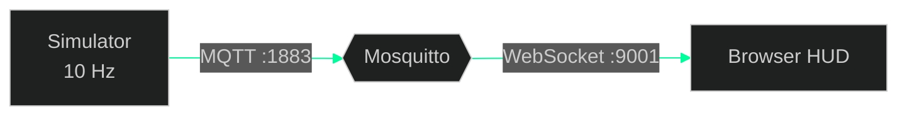

<div align="center">

# realtime-telemetry-platform

**Hardware telemetry → MQTT → live HUD.**
One command. No hardware required.

[**▶ Live demo**](https://flicky-official.github.io/realtime-telemetry-platform/hud/?demo) · [Run it locally](#run-it) · [Message contract](docs/protocol.md)


</div>

> The live demo link runs a simulation inside your browser so you can try the HUD instantly.
> The real pipeline (producer → broker → browser over WebSockets) is what `docker compose up` starts.

## Run it

```bash
git clone https://github.com/flicky-official/realtime-telemetry-platform
cd realtime-telemetry-platform
docker compose up
```

Open **http://localhost:8080**, then kill the producer to watch the HUD fail safe:

```bash
docker compose stop simulator    # HUD turns red: SIGNAL LOST
docker compose start simulator   # HUD recovers
```

## What it demonstrates

| | |
|---|---|
| **Pub/sub pipeline** | Producer → Mosquitto → browser over MQTT-on-WebSockets |
| **Fail-safe UI** | Stale data is never shown as live. After 2 s of silence the HUD flips to SIGNAL LOST |
| **Liveness** | Last Will & Testament: the broker announces `offline` if the producer dies |
| **Resilience** | Producer retries until the broker is up; browser auto-reconnects |
| **Contract first** | Topics, QoS and payloads documented in [`docs/protocol.md`](docs/protocol.md) |

## Architecture



## Design notes

- **QoS 0 for telemetry.** A dropped reading is replaced 100 ms later, so retransmitting old data is pointless.
- **QoS 1 + retained for status.** A late-joining client must learn online/offline immediately.
- **Simulator first.** Anyone can run the system without owning the hardware.
- **Producer timestamps.** `ts` is set at the source, so the HUD can show true message age and detect staleness.

## Roadmap

- [x] Simulator, broker, browser HUD
- [x] Fail-safe stale-data handling
- [x] Live in-browser demo
- [ ] C++ telemetry daemon (replaces the simulator on real hardware)
- [ ] Next.js and Blazor clients on the same topic contract
- [ ] MQTT 5 (message expiry for telemetry)
- [ ] PostgreSQL ingestion + Flutter client
- [ ] Latency benchmark
- [ ] TLS + authentication
- [ ] CI

## Known limitations

- The broker allows anonymous connections. **Demo only.** Production needs TLS and auth.
- Single vehicle, no persistence.
