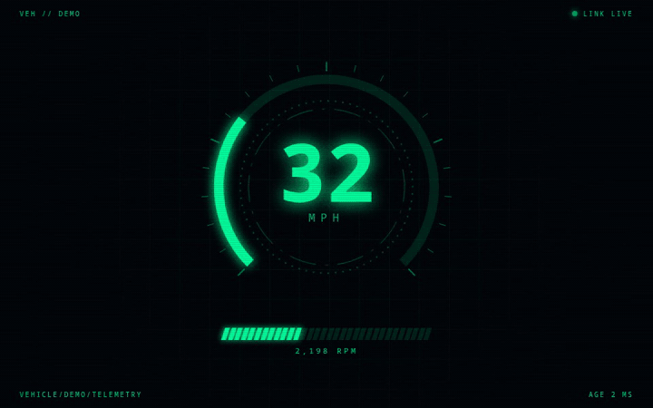
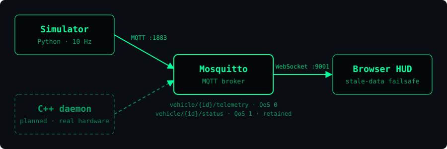

<div align="center">

# realtime-telemetry-platform

**Hardware telemetry → MQTT → live HUD. One command, no hardware required.**

[](https://github.com/flicky-official/realtime-telemetry-platform/actions/workflows/ci.yml)




</div>

## Quickstart

```bash
git clone https://github.com/flicky-official/realtime-telemetry-platform
cd realtime-telemetry-platform
docker compose up
```

Open **http://localhost:8080**. No Docker? Try the [live demo](https://flicky-official.github.io/realtime-telemetry-platform/hud/?demo), an in-browser simulation of the same HUD.

## Try the failure modes

The point of a telemetry display is knowing when to stop trusting it.

```bash
docker compose stop simulator    # producer dies  -> HUD turns red: NO DATA within 2 s
docker compose start simulator   # producer back  -> HUD recovers on its own
docker compose restart broker    # broker bounces -> browser reconnects, no refresh needed
```

## Architecture

<p align="center"></p>

| Component | Role |
|---|---|
| `simulator/` | Python producer publishing speed and RPM at 10 Hz, with a Last Will |
| `broker/` | Eclipse Mosquitto: MQTT on 1883, MQTT-over-WebSocket on 9001 for browsers |
| `hud/` | Static single-file dashboard (no build step) subscribing straight from the browser |

## Message contract

```text
vehicle/demo/telemetry   QoS 0   {"speed": 62.4, "rpm": 2800, "ts": 1718000000123}
vehicle/demo/status      QoS 1   "online" | "offline"   (retained, set via Last Will)
```

Full table and reasoning: [`docs/protocol.md`](docs/protocol.md)

## Design decisions

| Decision | Why | Tradeoff |
|---|---|---|
| QoS 0 for telemetry | A dropped reading is replaced 100 ms later; retrying old data is pointless | Occasional gaps are possible |
| QoS 1 + retained for status | A late-joining client must learn online/offline immediately | One retained message per vehicle |
| Last Will & Testament | The broker announces `offline` if the producer crashes | Detection time depends on keepalive |
| Producer-side timestamps | The HUD can compute true message age and detect staleness | Assumes roughly synced clocks |
| Browser connects directly via WebSocket | No backend to build or deploy | Needs auth and TLS before real use |
| Simulator first | Anyone can run the full system without the hardware | Not real sensor behaviour |

## Roadmap

| Now | Next | Later |
|---|---|---|
| Simulator, broker, HUD | C++ daemon replacing the simulator | MQTT 5 message expiry |
| Stale-data failsafe | Next.js and Blazor clients on the same contract | PostgreSQL ingestion + Flutter client |
| CI smoke test | Latency benchmark (p50/p95) | TLS + authentication |

## Repo layout

```text
.
├── broker/        Mosquitto config
├── simulator/     Python telemetry producer (Dockerfile included)
├── hud/           index.html (default view), cockpit.html (gauge view)
├── docs/          protocol.md, architecture diagram, demo assets
├── tools/         record_demo.py (regenerates docs/demo.gif)
└── docker-compose.yml
```

## Known limitations

- The broker allows anonymous connections. **Demo only.** Production needs TLS and auth.
- Single vehicle, no persistence.
- No latency numbers yet. They'll be added when measured, not estimated.
