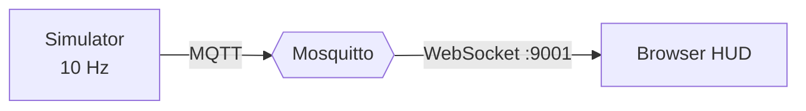

<div align="center">

# realtime-telemetry-platform

**Hardware telemetry → MQTT → live HUD. One command, no hardware required.**


</div>

## Run it

```bash
docker compose up
```

Open **http://localhost:8080**. Then run `docker compose stop simulator` to watch the HUD flag stale data.
Or try the [live demo](https://flicky-official.github.io/realtime-telemetry-platform/hud/?demo) (in-browser simulation).

## What this demonstrates

- A pub/sub telemetry pipeline: producer → broker → browser
- Reliability patterns: Last Will & Testament, stale-data detection, startup retry
- A documented message contract: [`docs/protocol.md`](docs/protocol.md)

## Architecture



## Design notes

- **QoS 0 for telemetry.** A dropped reading is replaced 100 ms later, so retransmitting old data is pointless.
- **QoS 1 + retained for status.** A late-joining client must learn online/offline immediately.
- **Simulator first.** Anyone can run the system without owning the hardware.

## Roadmap

- [x] Simulator, broker, browser HUD
- [ ] C++ telemetry daemon (replaces the simulator on real hardware)
- [ ] Next.js and Blazor clients on the same topic contract
- [ ] MQTT 5, PostgreSQL, Flutter client
- [ ] Latency benchmark
- [ ] TLS + authentication
- [ ] CI

## Known limitations

- The broker allows anonymous connections. **Demo only.** Production needs TLS and auth.
- Single vehicle, no persistence.
